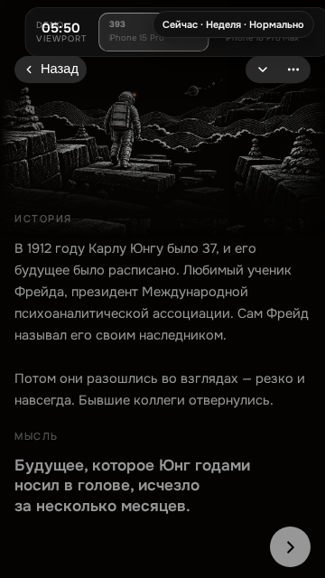
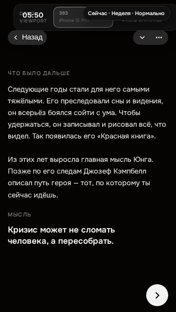
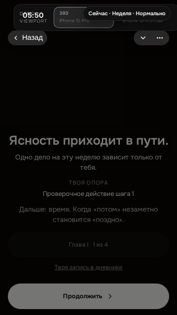

# PR #1120 — итог проверки «Пути героя»

Дата: 2026-10-21. Ветка: `hero-journey-ui`. Связанные задачи: #1096, #1112.

[PR #1120](https://github.com/Smira31/Mentalix/pull/1120) ·
[CI](https://github.com/Smira31/Mentalix/pull/1120/checks).

## Итог и границы доказательства

- **PASS:** публичная глава I в demo работает из встроенных данных, без запросов
  `/api/content/hero-journey`. Главы II–IV остаются закрытыми, без текстов во фронтенде.
- **PASS с тестовыми ответами:** обычный режим без `demo=1` действительно вызывает
  HTTP-клиент курса и передаёт bearer; успешный ответ становится источником `server`.
  Доступный шаг главы II не блокируется demo-изоляцией. Это проверка клиентского пути,
  **не** подтверждение серверной авторизации.
- **PASS с тестовыми ответами:** корректный пустой курс, пустое тело HTTP 200,
  HTTP 401, HTTP 403, HTTP 503, обрыв сети и некорректный JSON-объект различаются.
  Кнопка «Повторить» после ошибки повторно загружает курс и открывает четыре листа.
- **НЕ ПРОВЕРЕН:** настоящий авторизованный backend, фактические листы шагов 5–16
  и финала. Подтверждённой сервером сессии с нужными правами нет. Replay в живом
  превью содержал demo-состояние, а не доказанную серверную сессию.
- **НЕ ПРОВЕРЕН:** аппаратная клавиатура и Telegram/WebKit на iPhone.
- Merge и production deploy не выполнялись.

## Что изменено в этом продолжении

1. Регрессия воспроизведена тестом: HTTP 401 открывал общий экран ошибки сети без
   статуса `access`. Исправление передаёт причину отказа в существующий экран:
   401/403 — «Практикум недоступен для этого аккаунта.»; сеть/формат/5xx — прежняя
   ошибка загрузки. Тексты самого курса, вопросы, сохранение, прогресс и переходы
   не изменялись. Новый маршрут входа или обход авторизации не добавлялся.
2. Добавлена матрица браузерных тестов обычного режима на двух размерах. Подмены
   находятся **только в `tests/ux/hero-journey-content.spec.mjs`**, а не в приложении.
   `src/lib/api.js` не менялся: глобальный demo-перехват сохранён.
3. Исправлено устаревшее описание загрузчика: demo не подхватывает серверный курс.
   Вне demo загрузчик вызывает `api.content.heroJourney()` и не подменяет отказ
   публичным курсом.

## Таблица фактического контента по шагам

«Листы» ниже — элементы `pages`, а не число абзацев и не число экранов записи.
Вступление без `pages` **не считается четырёхлистной историей**. Наличие ID/картинки
в локальной структуре не доказывает наличия текста или доступности шага на сервере.
Публичные названия и структурные ID приведены без закрытых текстов.

| Шаг                                      | Источник текста                         | Листы истории / вступления         | Оформление                                                                                                       | Статус проверки                                                                                       |
| ---------------------------------------- | --------------------------------------- | ---------------------------------- | ---------------------------------------------------------------------------------------------------------------- | ----------------------------------------------------------------------------------------------------- |
| 1 · `uncertainty` · «Будущее не видно»   | Встроенный `demoContent.js`             | **4 листа**                        | Общий лист, текст + «МЫСЛЬ» рядом; зазор 20 px; исходная иллюстрация без blur; запись, действие, компактный итог | **PASS** на 430×932 и 360×640: все 4 листа целиком, переходы, сохранение и повторный вход             |
| 2 · `temporality` · «Ничто не навсегда»  | Встроенный `demoContent.js`             | **0 листов + 1 вступление**        | Общая оболочка вступления, исходная иллюстрация; запись, действие, компактный итог                               | **PASS** на обоих размерах; четырёхлистная история **отсутствует в доступном источнике**              |
| 3 · `choice` · «Усталость от выбора»     | Встроенный `demoContent.js`             | **0 листов + 1 вступление**        | Та же оболочка и компактный ритм; исходная иллюстрация                                                           | **PASS** на обоих размерах; четырёхлистная история **отсутствует в доступном источнике**              |
| 4 · `abundance` · «Рассыпанное внимание» | Встроенный `demoContent.js`             | **0 листов + 1 вступление**        | Та же оболочка, запись, действие, итог и пауза после главы                                                       | **PASS** на обоих размерах; четырёхлистная история **отсутствует в доступном источнике**              |
| 5 · `body`                               | Только backend; локально ID/изображения | Не установлено; в demo текстов нет | Общая оболочка подключена; настоящий текст не осмотрен                                                           | **НЕ ПРОВЕРЕН** на настоящем сервере; отдельно PASS синтетического доступного шага II главы, см. ниже |
| 6 · `phone`                              | Только backend; локально ID             | Не установлено; в demo текстов нет | Общая оболочка; иллюстрация зависит от ответа                                                                    | **НЕ ПРОВЕРЕН**, нет подтверждённой сессии                                                            |
| 7 · `autopilot`                          | Только backend; локально ID             | Не установлено; в demo текстов нет | Общая оболочка; иллюстрация зависит от ответа                                                                    | **НЕ ПРОВЕРЕН**, нет подтверждённой сессии                                                            |
| 8 · `digital-avatar`                     | Только backend; локально ID/изображения | Не установлено; в demo текстов нет | Общая оболочка подключена; настоящий текст не осмотрен                                                           | **НЕ ПРОВЕРЕН**, нет подтверждённой сессии                                                            |
| 9 · `comparison`                         | Только backend; локально ID/изображения | Не установлено; в demo текстов нет | Общая оболочка подключена; настоящий текст не осмотрен                                                           | **НЕ ПРОВЕРЕН**, нет подтверждённой сессии                                                            |
| 10 · `mirror`                            | Только backend; локально ID/изображения | Не установлено; в demo текстов нет | Общая оболочка подключена; настоящий текст не осмотрен                                                           | **НЕ ПРОВЕРЕН**, нет подтверждённой сессии                                                            |
| 11 · `loneliness`                        | Только backend; локально ID/изображения | Не установлено; в demo текстов нет | Общая оболочка подключена; настоящий текст не осмотрен                                                           | **НЕ ПРОВЕРЕН**, нет подтверждённой сессии                                                            |
| 12 · `relationships`                     | Только backend; локально ID/изображения | Не установлено; в demo текстов нет | Общая оболочка подключена; настоящий текст не осмотрен                                                           | **НЕ ПРОВЕРЕН**, нет подтверждённой сессии                                                            |
| 13 · `lost-supports`                     | Только backend; локально ID/изображения | Не установлено; в demo текстов нет | Общая оболочка подключена; настоящий текст не осмотрен                                                           | **НЕ ПРОВЕРЕН**, нет подтверждённой сессии                                                            |
| 14 · `age-crises`                        | Только backend; локально ID/изображения | Не установлено; в demo текстов нет | Общая оболочка подключена; настоящий текст не осмотрен                                                           | **НЕ ПРОВЕРЕН**, нет подтверждённой сессии                                                            |
| 15 · `meaning`                           | Только backend; локально ID/изображения | Не установлено; в demo текстов нет | Общая оболочка подключена; настоящий текст не осмотрен                                                           | **НЕ ПРОВЕРЕН**, нет подтверждённой сессии                                                            |
| 16 · `self-assembly`                     | Только backend; локально ID/изображения | Не установлено; в demo текстов нет | Общая оболочка подключена; настоящий текст не осмотрен                                                           | **НЕ ПРОВЕРЕН**, нет подтверждённой сессии                                                            |
| Финал · `return`                         | Только backend; локально ID/кадр        | Не установлено; в demo финала нет  | Общая оболочка и собственный кадр финала                                                                         | **НЕ ПРОВЕРЕН** на настоящих данных; PASS отдельного синтетического регрессионного теста на 393×852   |

У тестового шага `body` номер 5, но содержимое намеренно скопировано из **публичного**
шага 1 и явно названо «Тестовый шаг сервера». Четыре листа этого теста **не являются**
доказательством четырёх листов настоящего шага 5. Тест проверяет только то, что обычный
путь не выключен исправлением demo. Тестовый bearer не является действующей сессией.
Все API в этих сценариях перехвачены; реальных серверных записей они не создают.

## Матрица браузерных сценариев

| Сценарий                                               | 430×932     | 360×640     | Что доказано / источник                                                                                                                        |
| ------------------------------------------------------ | ----------- | ----------- | ---------------------------------------------------------------------------------------------------------------------------------------------- |
| Demo, публичная глава I                                | PASS        | PASS        | Встроенные данные, 0 запросов контента; 4 листа шага 1, по 1 вступлению шагов 2–4; запись/действие/итог; прогресс читается при повторном входе |
| Обычный режим, успех                                   | PASS        | PASS        | **Тестовый HTTP-ответ**: bearer в запросе, источник `server`, доступный тестовый шаг II главы, четыре публичных листа и переход к записи       |
| Корректный пустой курс `trials: []`                    | PASS        | PASS        | **Тестовый ответ**: статус `empty`, сообщение о подготовке практикума; нет ошибки и кнопки следующего шага                                     |
| HTTP 200 с пустым телом                                | PASS        | PASS        | **Тестовый ответ**: ошибка формата/загрузки, не пустой успешный курс; повтор успешно открывает курс                                            |
| HTTP 401                                               | PASS        | PASS        | **Тестовый ответ**: отказ доступа, не сеть/пустой курс; bearer удаляется; повтор отправляет новый запрос и применяет следующий тестовый ответ  |
| HTTP 403                                               | PASS        | PASS        | **Тестовый ответ**: отказ доступа, не сеть/пустой курс; bearer не удаляется; успешный повтор                                                   |
| HTTP 503                                               | PASS        | PASS        | **Тестовый ответ**: после ограниченного автоповтора ошибка загрузки; ручной повтор восстанавливает курс                                        |
| Сетевой обрыв                                          | PASS        | PASS        | **Тестовый обрыв запроса**: ошибка загрузки, а не пустота или demo-fallback; успешный ручной повтор                                            |
| Неверный объект `{ ok: true }`                         | PASS        | PASS        | **Тестовый ответ**: не принимается как курс; успешный повтор                                                                                   |
| Настоящая серверная сессия и выдача контента по правам | НЕ ПРОВЕРЕН | НЕ ПРОВЕРЕН | Нет подтверждённой сервером сессии; подмены выше этого не доказывают                                                                           |

После 401 тестовый успех следующего ответа проверяет обработку повторной загрузки,
**не** вход заново и **не** принятие сервером запроса без bearer.

**Отдельная проверка настоящего сервера, без подмен:** read-only запрос
`GET http://localhost:3000/api/content/hero-journey` через существующий Vite-proxy,
без Authorization и cookies, вернул **HTTP 401**, JSON-ошибку без `course` и `trials`.
Это подтверждает доступность пути и отказ анонимному клиенту, но не вход, не выдачу
авторизованному аккаунту и не браузерный сценарий на двух размерах. Тело ответа в
публичное evidence не перенесено.

## Оформление и измерения

Публичные шаги 1–4 проверены жестами: открыть → прочитать все фактические листы или
вступление → заполнить запись → заполнить действие → завершить → прочитать сохранённый
прогресс → вернуться на карту и повторно открыть курс. Контексты Playwright отдельные,
не содержат записей владельца; данные теста очищены, настоящие API-записи не создавались.

| Метрика                                                       | 430×932      | 360×640      |
| ------------------------------------------------------------- | ------------ | ------------ |
| Зазор основного текста до «МЫСЛЬ», все 4 листа                | 20 px        | 20 px        |
| Переполнение колонки / горизонтальный скролл                  | 0 / 0 px     | 0 / 0 px     |
| Фильтр на загруженных иллюстрациях                            | `none`       | `none`       |
| Имитация видимой высоты с клавиатурой                         | 596 px       | 360 px       |
| Низ поля / верх кнопки, запись и действие                     | 539 / 541 px | 303 / 305 px |
| Низ кнопки завершения                                         | 920 ≤ 932 px | 628 ≤ 640 px |
| Сохранение записи/действия и очистка черновика у всех 4 шагов | PASS         | PASS         |

Уменьшение высоты окна — только имитация доступного пространства, **не** настоящая
клавиатура iOS. Иллюстрации не заменены, blur не добавлен, существующие кадры сохранены.
Живое превью дополнительно проверено без подмен на 375×812: четыре публичных листа,
зазор 20 px, картинки загружены, `filter: none`, кнопки в кадре, запросов контента и
ошибок выполнения нет. Первый диагностический кадр на большом окне снялся до окончания
раскладки; после ожидания картинки повторный замер пройден. Это не доказательство iOS.

## Публичные скриншоты

Только публичная глава I и проверочные записи; закрытых текстов и действующих токенов
на изображениях нет. Префикс `test-` означает **тестовый ответ**, а не настоящий сервер.
Полные метрики: [430×932](final/430x932-metrics.json) · [360×640](final/360x640-metrics.json).

| Состояние                           | 430×932                                             | 360×640                                             |
| ----------------------------------- | --------------------------------------------------- | --------------------------------------------------- |
| Лист 1                              | [Кадр](final/430x932-sheet-1.png)                   | [Кадр](final/360x640-sheet-1.png)                   |
| Лист 2                              | [Кадр](final/430x932-sheet-2.png)                   | [Кадр](final/360x640-sheet-2.png)                   |
| Лист 3                              | [Кадр](final/430x932-sheet-3.png)                   | [Кадр](final/360x640-sheet-3.png)                   |
| Лист 4                              | [Кадр](final/430x932-sheet-4.png)                   | [Кадр](final/360x640-sheet-4.png)                   |
| Вступление шага 2 (не четыре листа) | [Кадр](final/430x932-step-2-intro.png)              | [Кадр](final/360x640-step-2-intro.png)              |
| Запись, имитация клавиатуры         | [Кадр](final/430x932-write-keyboard-simulated.png)  | [Кадр](final/360x640-write-keyboard-simulated.png)  |
| Действие, имитация клавиатуры       | [Кадр](final/430x932-action-keyboard-simulated.png) | [Кадр](final/360x640-action-keyboard-simulated.png) |
| Шаг пройден                         | [Кадр](final/430x932-complete.png)                  | [Кадр](final/360x640-complete.png)                  |
| Закрытые главы                      | [Кадр](final/430x932-locked-chapters.png)           | [Кадр](final/360x640-locked-chapters.png)           |
| Успех, тестовые данные              | [Кадр](final/430x932-test-success.png)              | [Кадр](final/360x640-test-success.png)              |
| Пустой курс, тестовый ответ         | [Кадр](final/430x932-test-empty-course.png)         | [Кадр](final/360x640-test-empty-course.png)         |
| 401, тестовый ответ                 | [Кадр](final/430x932-test-401.png)                  | [Кадр](final/360x640-test-401.png)                  |
| 403, тестовый ответ                 | [Кадр](final/430x932-test-403.png)                  | [Кадр](final/360x640-test-403.png)                  |
| 503, тестовый ответ                 | [Кадр](final/430x932-test-503.png)                  | [Кадр](final/360x640-test-503.png)                  |
| Сбой сети, тестовая подмена         | [Кадр](final/430x932-test-network.png)              | [Кадр](final/360x640-test-network.png)              |

### Листы и итог на низком экране

## Команды и результаты этого продолжения

Команды выполнены в действующем `app-web-1` (Node 22, Chromium). Запуск только одного
браузерного worker; полный UX-набор и установка WebKit локально не выполнялись.

| Проверка                                         | Команда внутри контейнера                                                                                                                           | Результат                                                                                                                                                                      |
| ------------------------------------------------ | --------------------------------------------------------------------------------------------------------------------------------------------------- | ------------------------------------------------------------------------------------------------------------------------------------------------------------------------------ |
| Воспроизведение дефекта                          | `VITE_TG_SHELL=0 npx playwright test --config=playwright.ux.config.mjs hero-journey-content.spec.mjs --grep "тестовый ответ 401: 430" --retries=0`  | RED до исправления: отсутствовал статус `access`                                                                                                                               |
| Модульные проверки курса                         | `node --test tests/unit/hero-journey*.test.mjs`                                                                                                     | PASS, 35 тестов                                                                                                                                                                |
| Demo-host и demo-прогресс                        | `node --test tests/unit/preview-demo-host.test.mjs tests/unit/demo-checkin-progress.test.mjs`                                                       | PASS, 4 теста                                                                                                                                                                  |
| Целевая браузерная проверка                      | `VITE_TG_SHELL=0 npx playwright test --config=playwright.ux.config.mjs hero-journey-content.spec.mjs hero-journey-reliability.spec.mjs --retries=0` | **PASS, 35 тестов, 1 worker, без retries**: 18 контентных + 17 регрессионных                                                                                                   |
| Lint                                             | `npm run lint`                                                                                                                                      | PASS по exit code, предупреждения не скрыты                                                                                                                                    |
| Сборка                                           | `npm run build`                                                                                                                                     | PASS                                                                                                                                                                           |
| Существующая защита dist                         | `npm run check:content-leak`                                                                                                                        | PASS, 96 текстовых файлов; контрольная публичная фраза есть, контрольные закрытые фразы шагов 5/16 отсутствуют. Это выборочный guard, не исчерпывающий аудит всех формулировок |
| Документация                                     | `npm run docs:check`                                                                                                                                | PASS; предупреждения о давности документов не скрыты                                                                                                                           |
| Тестовые данные вне бандла                       | Поиск тестового bearer и маркеров сценария в `dist/**/*.js` и `dist/**/*.map`                                                                       | PASS, совпадений нет                                                                                                                                                           |
| Полный `check:core` / полный `ux:check` / WebKit | Не запускались в этом продолжении                                                                                                                   | NOT RUN локально; полный набор — CI                                                                                                                                            |

## SHA и CI — без подмены статуса

Последний подтверждённый удалённый head PR: **`56653a20ab423dca64a09e47504c0c21048c0bd7`**
([проверки этого SHA](https://github.com/Smira31/Mentalix/commit/56653a20ab423dca64a09e47504c0c21048c0bd7/checks)).
Проверки выше выполнены на рабочем дереве **поверх** этого SHA; автокоммит этого
продолжения на момент составления отчёта ещё не существует. Поэтому этот SHA нельзя
называть итоговым, а его CI нельзя приписывать новым изменениям.

Наблюдение GitHub на **2026-10-21 06:15:16 UTC** для указанного SHA: **checks success —
13 passed, 0 failed, 0 pending, 2 skipped** (15 всего), PR mergeable, незакрытых
ревью-тредов нет. [Запуск CI](https://github.com/Smira31/Mentalix/actions/runs/39550998723).
Часом раньше (05:51:20 UTC) тот же набор ещё не был завершён: 11 passed, 1 pending
(`Playwright Chromium smoke`).

**Итоговый SHA и CI после автопуша — по-прежнему НЕ ПОДТВЕРЖДЕНЫ.** Платформа сохраняет
и отправляет изменения после окончания ответа; самостоятельно commit/push не выполнялись.
Нужно повторно прочитать head и статусы после автопуша. Технически CI на запушенном
head зелёный, но по существу задачи PR ещё не готов к merge: остаётся настоящая
авторизованная проверка ниже.

Превью PR (Firebase, собрано для коммита `56653a2`, доступно до 24.10.2026 05:42 UTC):
[`https://mentalix-production--pr-1120-qqjtfo6p.web.app/?demo=1&tab=library&action=hero_journey`](https://mentalix-production--pr-1120-qqjtfo6p.web.app/?demo=1&tab=library&action=hero_journey) —
проверено 21.10.2026, отвечает (страница входа/приложения отдаётся, 200).

## Что нужно для настоящей авторизованной проверки

1. Владелец входит в настоящий тестовый аккаунт через штатный вход в превью и
   предоставляет replay сессии; пароль, bearer и Telegram initData в чат не передаются.
2. Backend должен подтвердить аккаунт и права на нужные главы. Для закрытых глав
   нужны разрешённые аккаунту данные `/api/content/hero-journey`, без тестовых route.
3. На обоих размерах проверяются источник ответа, фактическое число `pages` каждого
   шага, переходы и оформление. В публичный отчёт попадают только счётчики и статусы;
   закрытые тексты, тела ответов, токены и закрытые кадры не публикуются.
4. Отдельно — ручной iPhone/Telegram gate с настоящей клавиатурой; затем решение
   владельца о merge и, отдельно, production deploy.
