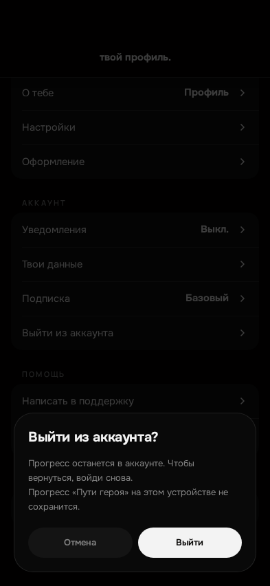
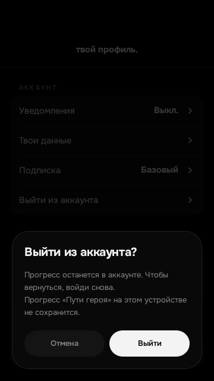
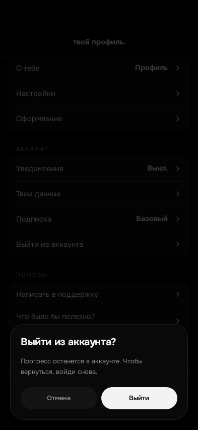
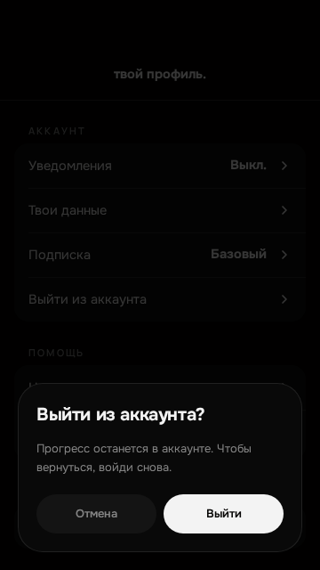

# ISSUE #1166 — «Выйти» стирает личные данные с устройства: отчёт о проверке

Рабочая ветка песочницы Base44 — `clear-user-data` (имя ветки выбирает платформа),
начата от свежего `main` a51d62d5; один PR в `main`. Открытого PR по #1166 не было,
незамерженного PR у рабочей ветки тоже.

## Что сделано

1. Одна функция очистки — `clearLocalUserData()` в `src/lib/localUserData.js`.
   Вызывается в `onLoggedOut` (`src/App.jsx`) после `api.auth.logout()` и
   `markWebLoggedOut()` (#1163).
2. Предупреждение в существующем окне выхода (`src/screens/Settings.jsx`).
   Строка «Прогресс „Пути героя“ на этом устройстве не сохранится.» показывается,
   только если на устройстве есть непустой прогресс или черновик шага
   (`hasLocalHeroJourneyData`, `src/lib/heroJourneyState.js`).
3. Тесты: `tests/unit/logout-local-data.test.mjs` и
   `tests/ux/logout-local-data.spec.mjs` (`npm run ux:logout-local-data`).

## Инвентаризация хранилищ (шаг 1 issue)

IndexedDB и Cache Storage приложение не использует — поиск по `src/` не нашёл ни
`indexedDB`, ни `serviceWorker`/`caches`. Данные человека лежат только в
`localStorage` и `sessionStorage`.

| Ключ | Что хранит | Выход | Почему |
| --- | --- | --- | --- |
| `mentalix_web_user` | кэш профиля (id, имя, username, email) | чистим | данные человека |
| `mentalix_session_token` | токен сессии веба | чистим | доступ к аккаунту |
| `mentalix_guest_merge_token` | токен слияния гостевого аккаунта | чистим | привязан к человеку |
| `mx-web-logged-out` | отметка «вышел сам» (#1163) | **оставляем** | не данные; без неё автозапуск гостя вернул бы человека в приложение |
| `mx-theme`, `mx-accent-color` | тема и акцент оформления | **оставляем** | нейтральная настройка устройства, экран входа выглядит как приложение |
| `mx-onboarded-v2`, `mx-onboarded-reset-v1`, `mx-onboarding-progress` | факт знакомства и ответы знакомства | чистим | ответы — о человеке; факт знакомства восстанавливается сервером (#1154) |
| `mx-app-lock-enabled`, `mx-app-lock-pin` | PIN-блокировка и её хеш | чистим | секрет человека; чужая блокировка не должна встречать следующего |
| `mx-birthday` | дата рождения | чистим | персональные данные |
| `mx-today-cards-hidden`, `mx-today-cards-hint-dismissed`, `mx-voice-hint-v1`, `mx-badges-seen`, `mx-insight-seen`, `mx-steps-hidden-practices`, `mx-history-filter`, `mx-history-granularity`, `mentalix_analytics_cards`, `mx-guest-save-reminder-hidden-until:<id>` | настройки поверхности, «уже показали», скрытые элементы | чистим | описывают поведение человека, часть — с его id |
| `mx-wtp-concept-test-v1*`, `mx-mentor-chat-draft-v1*` | ответы опроса, черновик диалога | чистим | личные ответы |
| `mx-checkin-draft-v1:*`, `mx-daily-journal-draft*`, `mx-evening-draft-v1*`, `mx-theme-draft-v1*`, `mx-thought-draft-v1*`, `mx-journal-draft-v3:<id>`, `mx-journal-v2`, `mx-daily-thoughts-cache-v1:<id>`, `mx-mood-check-draft` | записи и черновики | чистим | содержимое записей |
| `mx-hero-journey-progress:<id>`, `mx-hero-journey-draft:<id>:<step>`, `mx-course-progress:*`, `mx-course-draft:*` | прогресс курсов | чистим + предупреждение | в вебе/PWA живёт только на устройстве (CloudStorage есть лишь в Telegram) |
| `mx-series-snapshot:<id>`, `mx-series-preferences:<id>`, `mx-today-focus-v1*`, `mx-morning-pilot-v1*` | локальные снимки и предпочтения | чистим | собираются из данных человека |
| `mentalix:today:snapshot:v1:<id>`, `mentalix:trends:snapshot:v2:<id>:<days>`, `mentalix:streak:snapshot:v1:<id>`, `mentalix:theme-detail:v1:<id>:<theme>` (sessionStorage) | снимки дня, трендов, серии, темы | чистим | содержимое данных человека |
| `mx-progress-segment`, `mx-mentor-draft`, `mx-mentor-persona`, `mx-mentor-safety`, `mx-mentor-handoff`, `mx-settings-initial-screen`, `mx-settings-initial-sub`, `mx-mood-practice-initial`, `mentalix-library-read`, `mentalix-library-journal-entry-v1`, `mentalix-library-reader-swipe-hint-v1` (sessionStorage) | состояние экранов и переходов | чистим | часть — текст переданного вопроса и выбранные персоны |
| `mx-yookassa-payment-started`, `mx-yookassa-payment-resume`, `mx-subscription-success-shown`, `mx-donation-started`, `mx-donation-thanks` | отметки возврата с оплаты | чистим | относятся к платежу человека |
| `mx-chunk-reload-at` | защита от цикла перезагрузок чанков | чистим | технический страж, восстановится сам |
| `mx-pro-mock-state:v1`, `mentalix_preview_demo_state_v6`, `mentalix:demo-*` | dev/демо-состояние | чистим | не данные человека, в проде не появляются |
| `__telegram__*` | параметры запуска Telegram SDK | **оставляем** | служебные ключи SDK, без них мини-апп теряет параметры до закрытия |

Очистка сделана «белым списком»: стирается всё, кроме перечисленных выше
нейтральных и служебных ключей, — новый личный ключ в будущем не потребует
правки функции.

## Что проверено

| Проверка | Команда | Результат |
| --- | --- | --- |
| `check:core` (unit + ESLint + Vite build + content-leak + docs:check) | `docker compose … exec -T web npm run check:core` | PASS (весь конвейер дошёл до docs:check, 0 ошибок) |
| Модульные тесты, включая `tests/unit/logout-local-data.test.mjs` | `npm run test:unit` в web-контейнере | PASS: 1301 тест, 1298 passed, 0 failed, 3 skipped |
| Playwright #1166 | `npm run ux:logout-local-data` (`playwright.logout-local-data.config.mjs`, Chromium) | PASS: 4 теста (2 вьюпорта × с предупреждением / без) |
| Playwright #1163 (не сломан) | `npm run ux:web-logout` | PASS: 3 теста |

Сценарий Playwright #1166: вошёл (на устройстве остались профиль, токен, черновик,
дата рождения, прогресс «Пути героя», снимок дня) → «Выйти из аккаунта» → в окне
есть предупреждение → «Отмена» ничего не стирает → «Выйти» → в `localStorage` и
`sessionStorage` нет ни одного личного ключа, отметка `mx-web-logged-out` и
оформление устройства на месте → обновил страницу, по-прежнему экран входа →
вошёл тем же путём, что Telegram Login виджета → данные приложения снова пришли с
сервера (`mentalix_web_user`, флаг знакомства по `GET /api/profile`), а прогресс
«Пути героя» не вернулся — предупреждение было правдой.

Живое превью (песочница, демо-пользователь): окно выхода отрисовано существующими
стилями; текст диалога проверен по DOM — с прогрессом «Пути героя» строка есть,
без него строки нет. Выход в превью не подтверждался.

## Снимки

С предупреждением (393×852, 360×640):

Без предупреждения (393×852, 360×640):

## Что не запускалось (NOT RUN)

- Полный `npm run ux:check` и WebKit — CI.
- Живой iPhone: Safari и PWA «на экран Домой» — ручной gate владельца.
- Реальный `POST /api/auth/logout` боевого API не вызывался: ответы `/api/**`
  подменены моком.
- Наборы `ux:web-logout` и `ux:logout-local-data` в CI пока не подключены —
  запускаются отдельными командами.
