# Mentalix Pro (PRO-002b/c) — доказательства экранов

**Статус:** действующее доказательство прогона.
**Спецификация:** `tests/ux/pro-review-states.spec.mjs`, конфиг `playwright.pro-states.config.mjs`.
**Команда в web-контейнере:** `npm run ux:pro-states` (Chromium; перед первым прогоном — `npx playwright install --with-deps chromium`).
**Backend:** не требуется. Работает dev-only mock `?proMock=…` (`src/lib/proMock.js`); production-сборка mock не получает.
**Размеры:** 393×852 и 360×640, `?demo=1&frame=0` (демо-рамка не участвует в геометрии).

## 1. Почему кадры не могут быть заглушкой

Каждый кадр проходит через `createEvidenceWriter` (`tests/ux/typography-evidence.mjs`), который:

1. ждёт уникальный признак именно этого экрана и его видимость;
2. ждёт завершения анимации входа полноэкранного слоя;
3. снимает с `animations: 'disabled'`;
4. проверяет, что признак экрана на месте после снимка;
5. проверяет, что в области признака есть отрисованные пиксели;
6. отклоняет пустой кадр и кадр, **совпавший по хэшу с другим состоянием**.

Поэтому состояние либо снято как доказательство, либо прогон падает: «FAIL-» файл в этом наборе появиться не может.

Дополнительно на каждом кадре проверяется отсутствие горизонтального выхода
(`documentElement.scrollWidth ≤ clientWidth + 2`) с перечислением виновников в сообщении.

## 2. Удалённые заглушки `FAIL-*.png`

В каталоге лежали восемь файлов `FAIL-conflict.png`, `FAIL-crisis.png`, `FAIL-disabled.png`,
`FAIL-insufficient.png`, `FAIL-nopro.png`, `FAIL-ready.png`, `FAIL-rebuild_conflict.png`,
`FAIL-version_conflict.png`.

**Установленная причина:** все восемь были **одним и тем же кадром** — одинаковый размер
(121 713 байт) и одинаковый SHA1 `d222b99f50641485c8893c26168dec1e02c662fd`. То есть это была
не съёмка восьми состояний, а одна и та же картинка, размноженная по именам: прежний прогон до
этих состояний не доходил и записывал в них один кадр.

Замена выполнена только после того, как появились реальные кадры каждого состояния (разделы 3 и 4):
у всех них разные хэши, и это проверено самим писателем доказательств в одном прогоне.

## 3. Полный путь (393×852 и 360×640)

Оба набора сняты в одном прогоне, одинаковый список состояний; каталоги `393x852/` и `360x640/`.

| Файл                                        | Состояние                              | Сценарий mock |
| ------------------------------------------- | -------------------------------------- | ------------- |
| `1-consent.png`                             | Согласие на использование записей      | `ready`       |
| `2-report-not-generated.png`                | Разбор недели ещё не собран            | `ready`       |
| `3-report-ready.png`                        | Разбор недели готов                    | `ready`       |
| `4-plan-not-generated.png`                  | План недели ещё не собран              | `ready`       |
| `5-plan-ready.png`                          | План недели готов                      | `ready`       |
| `6-goal-edit-focus.png`                     | Правка общей цели: фокус, ввод 16px    | `ready`       |
| `7-day-edit-focus.png`                      | Правка действия дня: фокус, ввод 16px  | `ready`       |
| `8-progress.png`                            | Прогресс недели                        | `ready`       |
| `3a-report-details.png`                     | Подробности разбора раскрыты           | `ready`       |
| `3b-report-long-text.png`                   | Длинный текст разбора не обрезан       | `longtext`    |
| `3c-report-long-details.png`                | Длинные подробности разбора раскрыты   | `longtext`    |
| `0-pro-analytics-card.png`                  | Карточка входа в Pro рядом с образцом  | `ready`       |
| `0a-pro-card-waiting.png`                   | Карточка: пустое кольцо, разбор не собран | `ready`    |
| `0b-pro-card-ready.png`                     | Карточка: заполненное кольцо, разбор готов | `ready`   |
| `0c-pro-card-error.png`                     | Карточка: ошибка запроса и повтор загрузки | `network` |

Отдельная проверка того же набора (оба размера): карточка входа в Pro совпадает с образцом
владельца — существующей карточкой «Твои практики» в этой же аналитике — по ширине, высоте,
отступам, скруглению, фону и размерам заголовка/подписи. В кадре `0-pro-analytics-card.png`
обе карточки стоят рядом. Числа прогона: 393×852 — 361×185 против 361×185; 360×640 — 328×185
против 328×185 (ширина/высота карточки Pro против образца). Предусловие проверяется отдельно:
в демо без данных образец показывает пустое состояние.

Кольцо карточки отражает готовность РАЗБОРА, а не выполнение плана, и читается из данных
GET `/api/pro/report`: пустое кольцо при `not_generated`/`consent_required` («Подведи итоги
недели»), заполненное кольцо в акценте при `ready` («Разбор готов»), нейтральное пунктирное
кольцо с кнопкой «Повторить загрузку» при ошибке запроса. Процентов сборки нет; период — по
распознанным датам разбора (`неделя 6 окт — 12 окт`), а не «за текущую неделю». Готовность
перечитывается по данным после возврата из Pro (`refreshToken`), а не по нажатию кнопки; повтор
загрузки не отправляет POST (проверяется счётчиком mock-запросов).

Блокирующее ограничение контракта: `GET /api/pro/report` не сообщает состояние сборки —
`generation_in_progress` приходит только кодом ошибки POST 409, поэтому состояние «Собираем
разбор» из аналитики недостижимо, пока в GET-ответе нет признака сборки. Новый endpoint для
этого не изобретается. Карточка состояние сборки не показывает и статусом GET его не трактует:
кольцо знает только «разбор не собран» и «разбор готов». Код 409 и ограниченный опрос GET на
экране разбора (`src/lib/proGenerationPolling.js`) сохранены.

Внутренний дизайн готового разбора: направление на неделю — главный блок сверху, достижения
видны сразу, трудности/закономерности/темы — раскрываемые секции (`src/screens/pro/ProDetails.jsx`),
вопросы для размышления — отдельный блок. Прогон проверяет раскрытие реальным нажатием по
`summary`: до него текст трудности скрыт, после — виден; данные, даты, источники и дисклеймер
остаются в DOM. Типографика — токены читаемой шкалы (`--mx-read-*`), глобальная дизайн-система
не менялась.

Проверки MXL-KEYBOARD-001 внутри этого сценария: после нажатия «Изменить» фокус
(`document.activeElement`) стоит в `pro-goal-edit-input` / `pro-plan-edit-input` **без второго
нажатия по полю**, а фактический (computed) размер обоих полей — 16px.

## 3.1 Кадры: карточка, пустой и готовый разбор

Шесть кадров одного прогона `npm run ux:pro-states` (2026-10-14): карточка входа, разбор без
сборки и готовый разбор на 393×852 и 360×640.

| 393×852                                                       | 360×640                                                       |
| ------------------------------------------------------------- | ------------------------------------------------------------- |
| 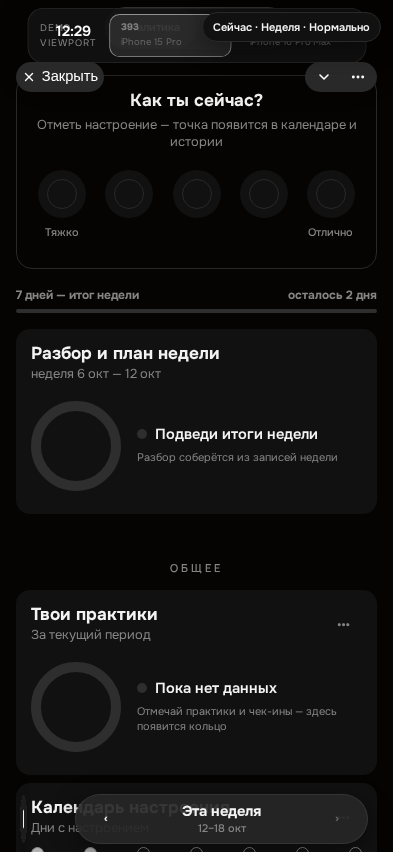 | 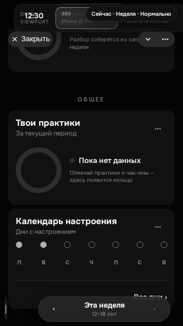 |
|  | 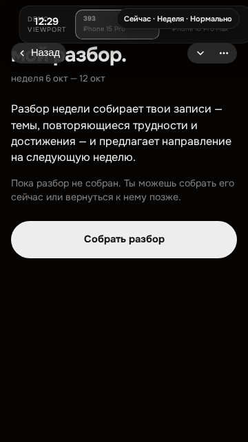 |
| 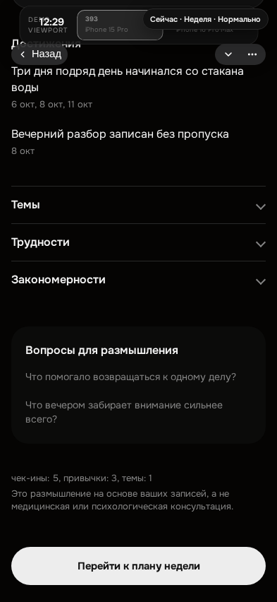         | 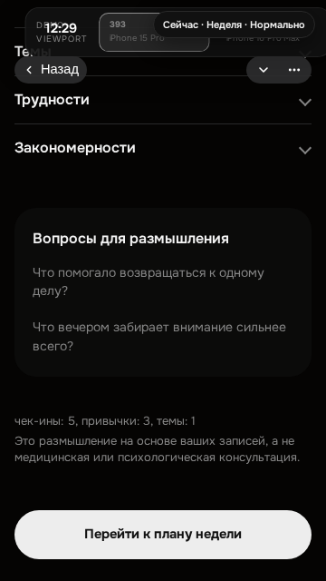         |

Раскрытые подробности разбора (темы, трудности, закономерности) — тот же прогон:

| 393×852                                                        | 360×640                                                        |
| -------------------------------------------------------------- | -------------------------------------------------------------- |
| 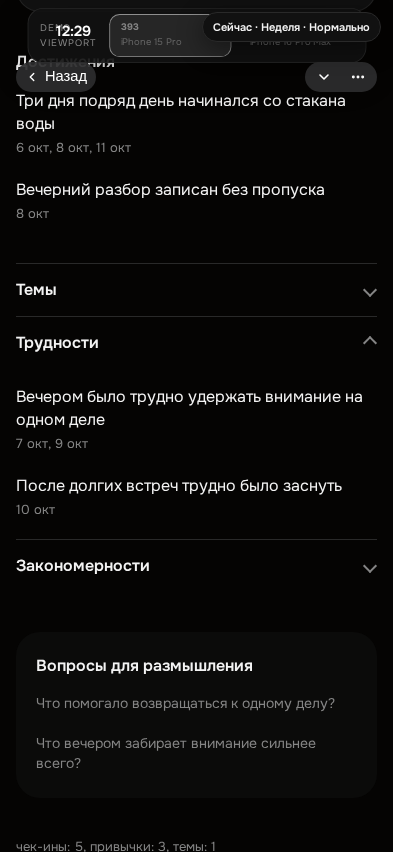 | 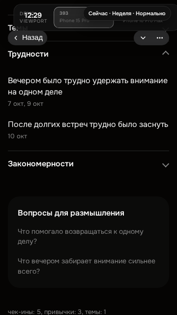 |

## 3.2 Длинный русский текст и возврат в аналитику (сценарий `longtext`)

Разбор недели — свободный текст AI, он бывает заметно длиннее образца. Сценарий
`?proMock=longtext` подаёт длинные русские строки (`src/lib/proMockLongText.js` — те же данные
читает спецификация, поэтому ожидание и mock не расходятся), а прогон проверяет не «на глаз», а
свойствами рендера: полное совпадение текста с данными mock, отсутствие
`text-overflow: ellipsis`, `-webkit-line-clamp` и `white-space: nowrap`, отсутствие клиппинга у
самого элемента и у предков с `overflow: hidden`, и перенос на несколько строк. Проверяются
направление на неделю, длинные тема, трудность и закономерность.

| 393×852                                                        | 360×640                                                        |
| -------------------------------------------------------------- | -------------------------------------------------------------- |
| 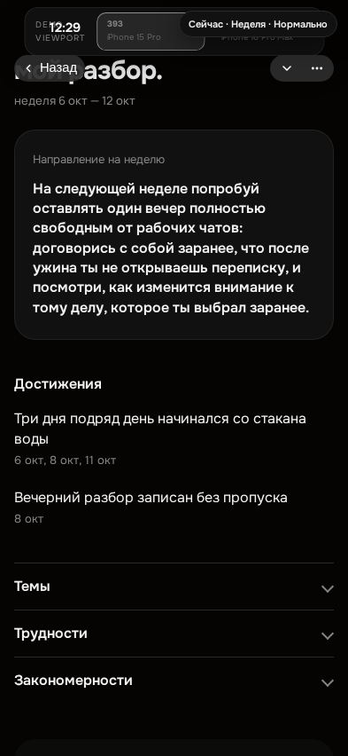 | 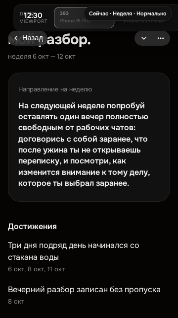 |
| 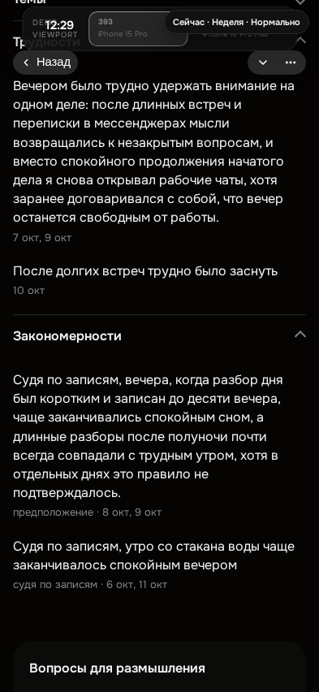 | 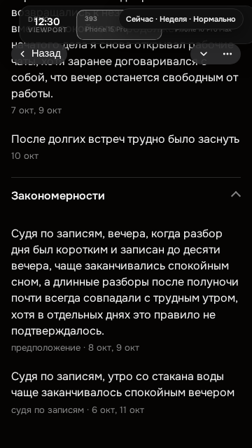 |

Возврат в аналитику проверяется тем же сценарием: период переключается на «Месяцы», аналитика
прокручивается на не нулевую позицию (карточка входа при этом остаётся в кадре — нажимается
именно она), открывается разбор, затем «Назад» — выбранный период и позиция прокрутки вкладки
(`scrollTop` контейнера аналитики) совпадают с состоянием до входа (±2 px). Аналитика не
размонтируется, поэтому состояние вкладки не теряется.

## 4. Ограничения доступа и особые ответы API (393×852)

| Файл                           | Состояние                                                        | Сценарий mock       |
| ------------------------------ | ---------------------------------------------------------------- | ------------------- |
| `9-blocked-nopro.png`          | 402 `pro_required` — «Mentalix Pro недоступен»                    | `nopro`             |
| `10-blocked-disabled.png`      | 404 `pro_report_disabled` — «Функция пока отключена»              | `disabled`          |
| `11-insufficient.png`          | 409 `insufficient_data` — «Недостаточно данных»                   | `insufficient`      |
| `12-crisis.png`                | 200 `crisis` — разбор не собирается, показан безопасный ответ     | `crisis`            |
| `13-conflict-ready.png`        | 409 `generation_in_progress` → ограниченный опрос GET → готово    | `conflict`          |
| `14-rebuild-conflict.png`      | 409 `rebuild_conflict` — план сохранён, пересборка не выполнена   | `rebuild_conflict`  |
| `15-version-conflict.png`      | 409 `version_conflict` — карточка решения, введённый текст сохранён | `version_conflict` |

В сценарии `13-conflict-ready` повторная POST-генерация не отправляется: после 409 идёт
ограниченный опрос GET (`src/lib/proGenerationPolling.js`), и кадр снят на готовом разборе.

## 5. Что осталось ручным gate (NOT RUN)

- Реальная клавиатура iPhone в Telegram (поднимается ли она сама) — автопрогон меняет высоту
  вьюпорта, но не поднимает системную клавиатуру. См. `docs/KEYBOARD_FOCUS.md` §5.
- WebKit локально не запускается в контейнере агента; его PASS требуется в CI на итоговом SHA.
