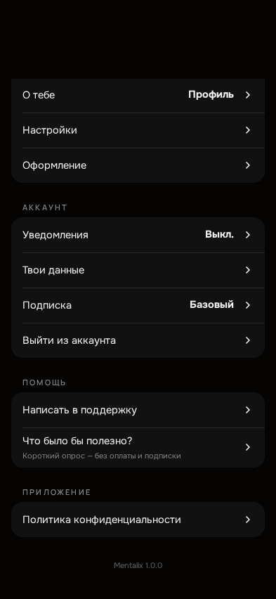
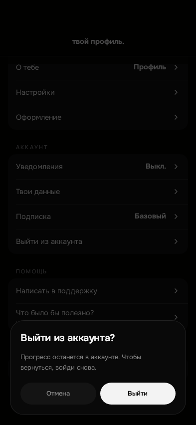
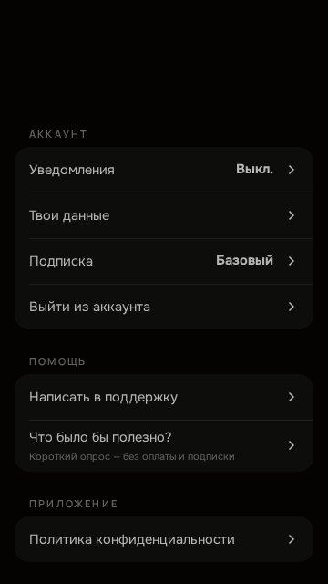
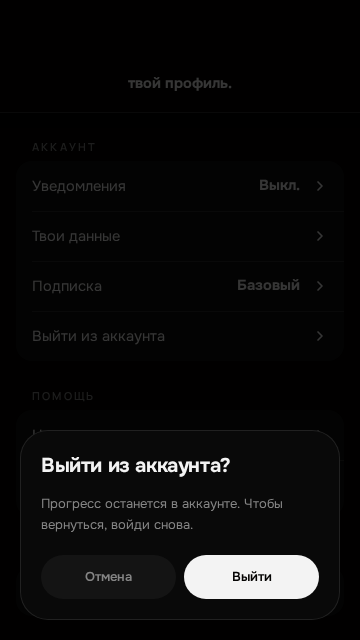

# ISSUE #1163 — «Выйти из аккаунта» в вебе и PWA: отчёт о проверке

Ветка `web-logout`, один PR в `main`. Ветка `fix-events-api` (#1162) не затрагивалась.

## Что проверено

| Проверка | Команда | Результат |
| --- | --- | --- |
| `check:core` (unit + ESLint + Vite build + content-leak + docs:check) | `docker compose ... exec -T web npm run check:core` | PASS (exit 0) |
| Модульные тесты, включая контракт #1163 (`tests/unit/web-logout-settings.test.mjs`) | `npm run test:unit` в web-контейнере | PASS: 1292 passed, 0 failed, 3 skipped |
| Playwright: веб-сценарий | `npm run ux:web-logout` (`playwright.web-logout.config.mjs`, Chromium) | PASS: 3 теста |
| Мутационная проверка гостевого предохранителя | убрать `!isWebLoggedOut()` из `checkAuth` → прогнать набор → вернуть | без предохранителя оба веб-сценария падают на шаге «обновил → экран входа», с ним PASS |

Сценарий Playwright: вошёл → пункт «Выйти из аккаунта» → «Отмена» (остаётся в профиле) →
«Выйти» → экран входа без перезагрузки → локальный пользователь и токен сессии пусты →
обновил страницу → снова экран входа. Набор включает путь боевых хостов
(`window.__MX_TEST_ALLOW_GUEST = true`): без отметки «вышел сам» приложение создало бы
гостя и вернуло человека в приложение. Отдельный тест: в Telegram Mini App пункта нет.

Живое превью: пункт в группе «Аккаунт» и окно «Выйти из аккаунта?» с кнопками
«Отмена» / «Выйти» отрисованы существующими стилями профиля; выход в превью не
подтверждался (там была сессия владельца).

## Снимки

393×852:

360×640:

## Что не запускалось (NOT RUN)

- Полный `npm run ux:check` — CI.
- WebKit — CI.
- Живой iPhone: Safari и PWA «на экран Домой» — ручной gate владельца.
- Реальный `POST /api/auth/logout` боевого API из песочницы не вызывался: сетевой
  ответ в Playwright подменён моком.
- Набор `ux:web-logout` в CI пока не подключён — запуск отдельной командой.
